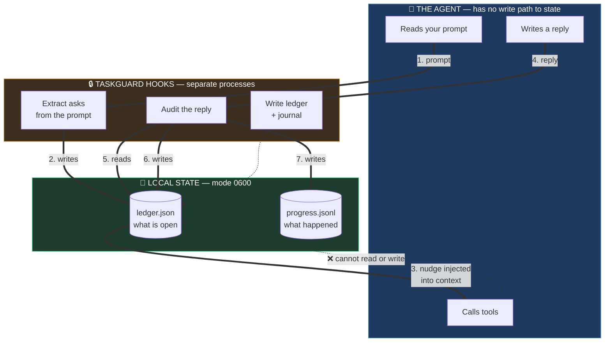
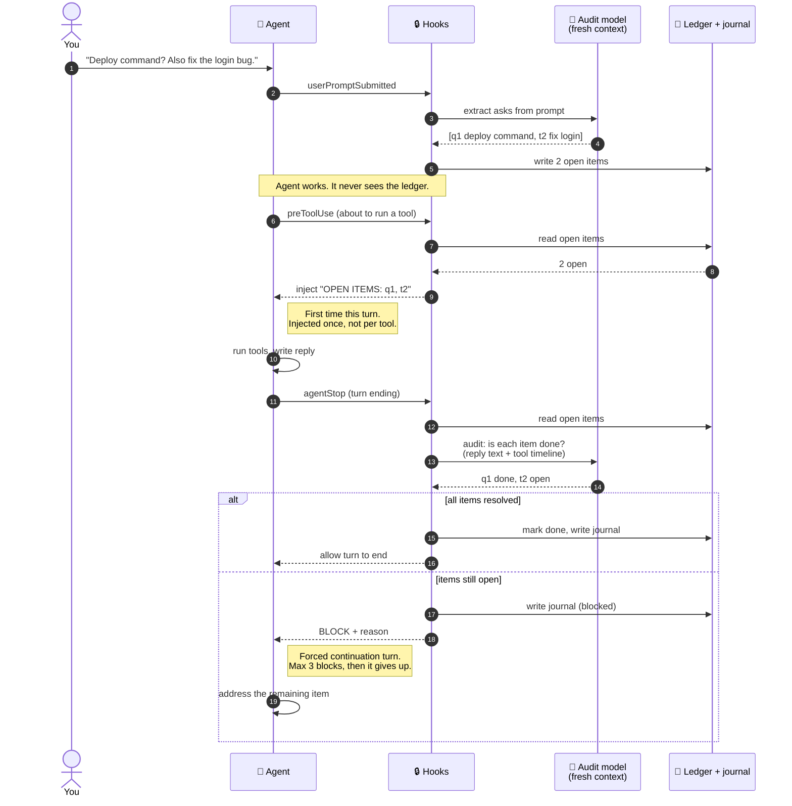
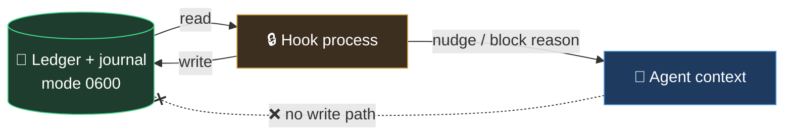
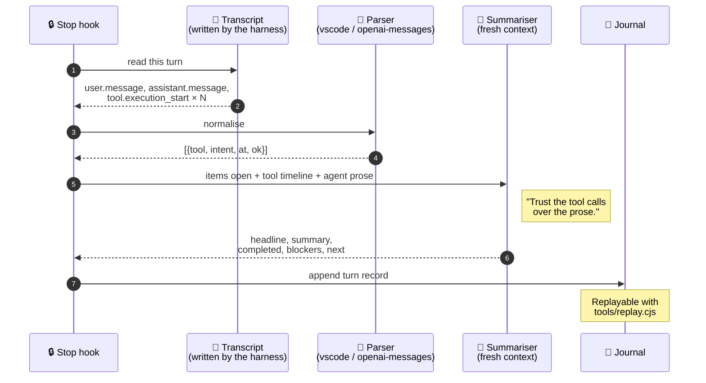

# taskguard

**A VS Code Copilot hook that stops the agent from silently dropping your questions and tasks.**

You ask three things in one message. The agent answers two and moves on. You only notice later. `taskguard` tracks every question and task you submit, and refuses to let the turn end until each one is either answered or explicitly dismissed.

```
You:  What's the deploy command? Also fix the login bug. And is the cache warm?

Agent: The deploy command is `make deploy`.

⚠ Warning from Stop hook
TASKGUARD NUDGE #2: turn blocked — 2 item(s) still open
  - [q1] What's the deploy command?
  - [t2] Fix the login bug
  - [q3] Is the cache warm?

⛔ Blocked by Stop hook
Turn ended with 2 unresolved item(s). Address each one or state why it is
no longer needed.
```


## Who controls what

The single most important thing to understand: **the agent never touches the
ledger.** It has no write path. It cannot mark its own items done, cannot edit
the journal, and cannot see the audit prompt.

That separation is the whole design. An agent that could update its own
scorecard would be grading its own homework.



Three properties fall out of this:

| Property | Why it matters |
|---|---|
| **The agent cannot lie to the ledger** | No write path. Only hooks write state. |
| **The audit is independent** | A separate model call with a fresh context reads the evidence. |
| **The agent cannot see the audit** | The audit prompt is never in the agent's context. |

## How it works

Five hooks, three of which never touch the network:

| Event | Adapter | What it does | Cost |
|---|---|---|---|
| `sessionStart` | `session.cjs` | Re-injects items carried over from a previous session | free |
| `userPromptSubmitted` | `prompt-submitted.cjs` | Extracts questions and tasks from your prompt | 1 small call |
| `preToolUse` | `before-tool.cjs` | Injects the open-items list once per turn | free |
| `postToolUse` | `after-tool.cjs` | Reminds the agent mid-turn | free |
| `agentStop` | `turn-end.cjs` | Audits the turn; blocks if items are unresolved; writes the progress journal | 2 small calls |

Three model calls per turn, all small and bounded. See [Cost](#cost).

### One turn, end to end

This is the full lifecycle. Note where the agent is *not* involved — every
decision about what counts as done happens outside it.



### What the agent sees vs. what it does not

The boundary is worth stating explicitly, because it is what makes the
enforcement trustworthy. Everything in the right column is invisible to the
agent — it is not in its context, and it has no way to read it.

| ✅ In the agent's context | 🔒 Never in the agent's context |
|---|---|
| Your prompt | The audit prompt |
| The open-items nudge | The audit model's verdicts |
| The block reason | The ledger file itself |
| Its own tool results | The journal |
| | Your API key |

The flow is **one-way**: hooks can inject nudges and block turns, but the agent
has no channel back. It cannot mark an item done, cannot edit the journal, and
cannot see why the audit decided what it decided.



### Where the evidence comes from

The audit does not take the agent's word for it. It reads the harness
transcript, which records what actually ran.



The key instruction is **trust the tool calls over the prose**. If the agent
says it ran the tests but no test command appears in the timeline, the report
says so.

### The progress journal

The ledger answers *"what is still open?"*. It does not answer *"what happened
in the last 30 minutes?"* — and on a long run that is the question you actually
have. So every turn also appends a record to a journal you can replay:

```bash
node tools/replay.cjs <sessionId> --step      # step through, Enter for next
node tools/replay.cjs <sessionId> --last 3    # just the newest 3 turns
node tools/replay.cjs <sessionId>             # the whole thing at once
node tools/replay.cjs <sessionId> --turns     # summaries only, no tool calls
node tools/replay.cjs <sessionId> --follow    # live, like tail -f
```

**`--step` is the one to use on a long session.** Reading 40 turns as one wall
of text means scrolling past the part you cared about. Stepping shows one turn
at a time:

```
═══ stepping through 12 turn(s) ═══

14:15:11 ✓ t1 Fixed the duplicate EventBridge targets 45s ▏████████
      ✔ target_id pinned on 3 rules
      open: 3 ↓2
14:15:12   ⌘ run_in_terminal terraform plan

  turn 1 of 12  ·  [enter] next  ·  [a] all  ·  [q] quit
```

`[enter]` advances, `[a]` dumps the rest, `[q]` stops. When stdout is not a
terminal (piped, CI) it prints everything rather than waiting for a keypress
that can never arrive.

**`--last N` is for watching a session live.** You do not want to re-read all
ten turns every time you check in — `--last 2` shows just the newest two, with
their tool calls.

```
═══ session replay ═══
span 13:27:15 → 14:02:59 (35m44s)  turns 4  tools 12  resolved 5  blocked 1

13:27:15 ✓ t1 Fixed the duplicate EventBridge targets 45s ▏████████
      ✔ target_id pinned on 3 rules
      → verify plan
      files: scheduler.tf
      open: 3 ↓2

13:28:15 ✓ t2 Found the real cause: reasoning tokens ate the output budget 45s ▏██████
      ✔ reasoning disabled
      → rerun audit
      files: llm.cjs
      open: 2 ↓1

13:29:15 ⛔ t3 Wrote the installer smoke test; it caught a missing file 45s ▏█████████
      ✔ CI job added
      ▲ verdict-check.cjs was never copied
      → fix copy list
      files: ci.yml
      open: 1 ↓1
```

**Each turn line names the material effect, not the activity.** "Ran 12 tool
calls" tells you nothing; "Fixed the duplicate EventBridge targets" tells you
what changed in the world. The summariser is instructed to write the headline
as a past-tense verb plus the thing that changed, and to name what was
*learned* when the turn was pure investigation.

**The summary is written by a separate model call, not by the agent.** The
agent has its own context and an incentive to look successful; asking it to
report on itself means asking it to grade its own homework. The summariser gets
a fresh context and sees only three things: the items open at turn start, the
tool calls that actually ran, and the agent's prose. It is instructed to
**trust the tool calls over the prose** — if the agent says it ran the tests but
no test command appears in the timeline, the report says so.

**The tool timeline comes from the VS Code transcript, not from our own
instrumentation.** The transcript already records every `tool.execution_start`
with a real timestamp and structured arguments, so there is nothing to add and
nothing to miss. It is also complete for turns where our hooks did not fire.

### The session changelog

The journal is the source of truth for *what happened*. The changelog is that
same record **persisted where other systems can consume it** — written
automatically on every turn, so you never have to remember to run anything.

**Reading never writes. Writing is a separate verb.**

```bash
# READ — no side effects
node tools/changelog.cjs --list                # every indexed session
node tools/changelog.cjs --list --kind code    # only code sessions
node tools/changelog.cjs --list --since 7d     # last week
node tools/changelog.cjs --list --all          # ignore the 5000-record cap
node tools/changelog.cjs --show <sessionId>    # print the changelog
node tools/changelog.cjs --path <sessionId>    # print just the file path

# WRITE — regenerates the file on disk
node tools/changelog.cjs --write <sessionId>

# MAINTENANCE
node tools/changelog.cjs --prune --keep 500        # keep the newest 500
node tools/changelog.cjs --prune --older-than 30d  # drop records older than 30d
node tools/changelog.cjs --prune --dry-run         # report, change nothing
```

`--show` and `--path` never touch the disk. `--write` is the only command that
regenerates a file, and it says so when it does. A bare session id defaults to
the read path and tells you how to write.

**Files are named by date plus a slug of the first headline**, not the session
UUID — `2026-10-27T05-14-40-fixed-the-retry-logic-f03aef.md` rather than
`2026-10-27T05-14-40-f03aef59-33eb-41bd-9298-81d48f52c4d8.md`. A UUID is
unique but unreadable; the headline is what you scan for. A short session
prefix is kept so two sessions with the same opening headline cannot collide.

**The index is append-only and never pruned automatically.** `--list` reads the
newest 5,000 records by default and **says so when it truncates** — a list that
looks complete but is silently missing history is worse than one that admits
it. Use `--all` to read everything, or `--prune` to bound the file.

**A changelog is repo-shaped. Agent sessions are not.** That is the design
problem this solves. A `git diff`-based changelog produces *nothing* for a
session where you asked the agent to search your filesystem or move files
around — the work just vanishes. So the record is **classified by activity**
instead, from the tool timeline:

| Class | Detected from | Needs a repo? |
|---|---|---|
| `code` | file writes and edits | no — git section is just omitted |
| `filesystem` | moves, deletes, renames | no |
| `research` | reads, searches, fetches | no |
| `mixed` | more than one of the above | no |
| `none` | only shell commands, or nothing | no |

Classification comes from the **tool timeline**, not the agent's claims. An
agent that says it edited files but only ran `ls` classifies as `research`.

**Two outputs:**

| Output | Purpose |
|---|---|
| `<workspace>/changelog/YYYY-MM-DD-HHmmss-<session>.md` | Human-readable, committable. Same format as the manual `ChangelogAgent`, so downstream tooling does not care which produced it. |
| `~/.copilot/hooks/ledger/.ledger/changelog-index.jsonl` | Append-only, one record per session. **Survives across workspaces**, so you can ask "what did agents do this week" without knowing which repo they touched. |

The workspace file is **rewritten in place** each turn — one file per session,
not 40 fragments. The index is append-only.

**This does not replace the manual `ChangelogAgent`.** That agent reads the
actual diff and writes prose about *why* each change was made. This hook
records *what happened* from the timeline. They are complementary: the hook
gives you automatic coverage, the agent gives you depth when you want it.

Set `LEDGER_CHANGELOG=0` to disable it.

### OpenTelemetry

VS Code **does** emit OTel for Copilot agent activity — traces, metrics, and
events, with `invoke_agent`, `chat`, `execute_tool`, and `execute_hook` spans
following the [GenAI semantic conventions](https://github.com/open-telemetry/semantic-conventions/blob/main/docs/gen-ai/).
See [Monitor agent usage with OpenTelemetry](https://code.visualstudio.com/docs/agents/guides/monitoring-agents).

It is **off by default**. To turn it on:

```jsonc
{
  "github.copilot.chat.otel.enabled": true,
  "github.copilot.chat.otel.exporterType": "file",   // or otlp-http, otlp-grpc, console
  "github.copilot.chat.otel.outfile": "/tmp/copilot-otel.jsonl",
  "github.copilot.chat.otel.captureContent": true    // needed for tool arguments
}
```

`taskguard`'s journal is **complementary, not a replacement**. VS Code's OTel
gives you spans and token counts; it does not tell you what a turn *achieved*.
The journal adds the narrative layer on top, and can export in OTLP shape so it
lands in the same backend:

```bash
node tools/replay.cjs --latest --otlp > spans.json
```

If you already run an OTel collector, point VS Code at it and use the journal
for the "what did it accomplish" question the spans cannot answer.

### The audit is strict on purpose

The `turn-end` hook sends the turn's final message to a model with a deliberately harsh prompt. It defaults to `open` when uncertain, and it rejects:

- promises ("I'll do that next") — a promise is not a completion
- partial work — half a task is not a task
- mentions — describing a problem is not addressing it

It must cite evidence from the response to mark something done. If it cannot, the item stays open and the turn is blocked.

### It gives up eventually

`MAX_BLOCKS = 3` per turn. After three blocked turns the hook stops blocking and lets the turn through, so a stubborn disagreement cannot trap you in a loop. The budget resets on your next prompt.

### Duplicates are collapsed

The extractor is a model, so the same request re-extracted in a later turn comes back paraphrased ("Create a Git repo…" vs "Create a git repository…"). Two mechanisms handle this:

**Lexical, always on.** Meaningful words are compared, with dotted identifiers (`ai.js`, `db.js`) kept whole so "Add tests for ai.js" and "Add tests for db.js" stay distinct. This catches rewordings that share most of their vocabulary, for free.

**Model-assisted, when the ledger is large.** Lexical matching cannot catch a rephrasing that shares almost no vocabulary — "omit the actual task details" vs "not tell what the tasks are" share only one word, and score *lower* than two genuinely different asks. Once 12 or more items are open, one extra small call groups the semantic duplicates and keeps the broadest wording. Merged items are marked `dropped` with a note pointing at the survivor, so the history stays auditable.

Without this, a long session accumulated 29 open items for ~20 real asks, which made every nudge noisy and left the audit unable to resolve anything.

## Architecture

```
core/                 framework-agnostic. Knows nothing about any harness.
  index.cjs           the five lifecycle functions an adapter calls
  ledger.cjs          state: load, save, merge, dedupe, prune
  extract.cjs         the three prompts (extract, reconcile, summarise)
  journal.cjs         per-turn progress records + tool timeline
  parsers.cjs         transcript parsers, one per harness  <- the portability seam
  llm.cjs             provider-agnostic model client
  trace.cjs           local trace log

adapters/vscode/      thin translation only. ~250 lines, mostly comments.
  session.cjs         sessionStart        -> onSessionStart
  prompt-submitted.cjs userPromptSubmitted -> onPromptSubmitted
  before-tool.cjs     preToolUse          -> onBeforeTool
  after-tool.cjs      postToolUse         -> onAfterTool
  turn-end.cjs        agentStop           -> onTurnEnd

tools/                operator commands (inspect, caps, cost, replay)
```

The split exists so porting is a folder, not a fork. `core/` has no `require`
of anything harness-specific, and the adapters contain no enforcement logic —
they read an event, call one function, and emit the harness's own output shape.

## Porting to another agent framework

**If you are an agent asked to port this:** read [`docs/ADAPTERS.md`](docs/ADAPTERS.md).
It is written as a step-by-step task list with a checklist at the end.

There are **two** seams, and most ports only need the first.

### Seam 1 — the adapter (required)

Five lifecycle moments: session start, prompt submitted, before tool, after
tool, and **turn end**.

1. `cp -r adapters/vscode adapters/<yours>` and rewrite the six small files.
2. The only hard requirement is that **turn end** can block and force another
   turn with a reason string. Everything else is advisory.
3. Copy `test/hook-scripts.test.js`, point `ADAPTER_DIR` at your adapter, run it.
4. Document which lifecycle moments your harness lacks.

`core/` needs no changes. If you find yourself editing it, the adapter is
probably doing something the core should own — open an issue instead.

### Seam 2 — the transcript parser (only if you want the journal)

The progress journal needs to know what tools ran during a turn. It gets that
from the harness's transcript, and every harness stores transcripts
differently. So parsing lives in `core/parsers.cjs`, behind a registry.

A parser is one object with one function:

```js
const mine = {
  name: 'my-agent',
  description: 'My agent\'s JSONL log',

  parse(file) {
    // Return the normalised shape. Return [] rather than throwing.
    return [{
      index: 1,                          // 1-based, in order
      startedAt: '2026-10-27T10:00:00Z', // ISO 8601
      endedAt:   '2026-10-27T10:01:00Z',
      userText: 'what the human asked',
      assistantText: 'what the agent said',
      tools: [{
        tool: 'run_in_terminal',         // tool name
        intent: 'npm test',              // short human-readable summary
        at: '2026-10-27T10:00:30Z',      // ISO 8601
        ok: true,                        // did it succeed
      }],
    }];
  },
};

// core/parsers.cjs
const PARSERS = {
  [vscode.name]: vscode,
  [openaiMessages.name]: openaiMessages,
  [mine.name]: mine,          // <- add yours
};
```

Then either pass it explicitly or let auto-detection find it:

```js
journal.parseTurns(path, 'my-agent');   // explicit
journal.parseTurns(path);               // sniffed from the file contents
```

**Two parsers ship today:**

| Parser | Format | Covers |
|---|---|---|
| `vscode` | JSONL with `type: "user.message"` / `"tool.execution_start"` | VS Code Copilot Chat |
| `openai-messages` | JSON array or JSONL of `{role, content, tool_calls}` | LangChain, LlamaIndex, OpenAI SDK, most homegrown loops |

Auto-detection sniffs the first 4 KB and picks the shape that fits, so in
practice you often get the journal for free. If your harness logs a message
list with `role` fields, `openai-messages` probably already works.

**If you skip this seam entirely**, everything still works — you just get no
progress journal. The ledger, the audit, and the blocking behaviour do not
depend on it. `onTurnEnd` degrades to using the response text alone.

### Frameworks this should map onto

| Framework | Turn-end blocking | Transcript parser | Notes |
|---|---|---|---|
| VS Code Copilot | yes | `vscode` | reference implementation |
| Claude Code | yes | write one | `Stop` hook with a block decision |
| Cursor | partial | write one | check whether hooks can force a turn |
| LangChain / LlamaIndex | yes | `openai-messages` | you own the loop, so you own the hook |
| Any OpenAI-compatible loop | yes | `openai-messages` | likely works unchanged |

If your framework cannot block at turn end, the adapter still works as a
reminder system — say so in your README rather than implying enforcement.

## Install

Requires **Node.js 18+** and an API key for your chosen provider.

```bash
git clone https://github.com/shameekASC5/taskguard.git
cd taskguard
./install.sh
```

The installer asks which provider and model you want, prompts for the key (input hidden), writes it to `~/.copilot/hooks/ledger/.env` with mode `600`, then runs a health check, a cap check, and a cost estimate.

**Then start a new chat session.** Hook config is read once at session start, so it will not work in the session you installed from.

### Non-interactive (for agents and CI)

```bash
./install.sh --key sk-or-v1-... --provider openrouter --model deepseek/deepseek-v4.1-flash
```

Set `LEDGER_NONINTERACTIVE=1` to guarantee no prompt ever blocks, even if stdin looks like a terminal.

### Other flags

```bash
./install.sh --dry-run     # show every action, change nothing
./install.sh --uninstall   # remove everything this script installed
```

Re-running `install.sh` is safe. It backs up any existing `ledger.json` first.

### Choosing where things go

Every path is overridable, by flag or environment variable. A leading `~` is
expanded.

| Flag | Env var | Default |
|---|---|---|
| `--hooks-dir DIR` | `TASKGUARD_HOOKS_DIR` | `~/.copilot/hooks/ledger` |
| `--config FILE` | `TASKGUARD_CONFIG` | `~/.copilot/hooks/ledger.json` |
| `--instructions-dir DIR` | `TASKGUARD_INSTRUCTIONS_DIR` | `~/.copilot/instructions` |

```bash
# Keep everything under your own dotfiles layout
./install.sh --hooks-dir ~/dotfiles/copilot/taskguard \
             --config   ~/dotfiles/copilot/hooks.json

# Drop the instruction file into the directory you already registered
./install.sh --instructions-dir ~/my-instructions
```

**If you already have an instructions directory registered** in
`chat.instructionsFilesLocations`, the installer uses that one automatically
instead of creating a second. It prints which directory it picked, and
`--instructions-dir` overrides it.

This matters because VS Code only loads instruction files from registered
directories. Installing into a directory that is not registered looks
successful but does nothing.

### Letting an agent install it

Paste this into a Copilot chat:

> Clone https://github.com/shameekASC5/taskguard, read the README, and install
> it. Ask me which provider and model I want and for the API key — do not invent
> one. Run `./install.sh --key <key> --provider <p> --model <m>`, then
> `~/.copilot/hooks/ledger/inspect.sh doctor`, and report the result.

The installer is non-interactive with `--key`, prints a clear pass/fail health check, and exits non-zero on failure, so an agent can verify its own work.

## Choosing a model and provider

**OpenRouter is the default, not a requirement.** Any endpoint that speaks the OpenAI chat-completions shape works.

| Provider | `--provider` | Notes |
|---|---|---|
| OpenRouter | `openrouter` | One key for every model. Default. |
| OpenAI | `openai` | |
| Groq | `groq` | Very fast, cheap |
| DeepSeek | `deepseek` | Direct, cheapest for DeepSeek models |
| Together | `together` | |
| Fireworks | `fireworks` | |
| Ollama | `ollama` | Local, no key, no cost |
| Custom | `custom` | Any OpenAI-compatible URL |

The default model is **`deepseek/deepseek-v4.1-flash`** — cheap, fast, and reliable at JSON output, which is all these two calls need.

If you switch provider but leave an OpenRouter-style model id configured, `taskguard` warns and falls back to that provider's default rather than sending a request that is guaranteed to 404.

### Reasoning is turned off, including on your own reasoning model

**If you bring a reasoning model — o-series, DeepSeek-R1, QwQ, a thinking variant of anything — `taskguard` will tell it not to think, and you should leave it that way.**

These are not hard problems. The two calls are:

- *"Which of these sentences are questions or tasks?"*
- *"For each item, did the response report it as done?"*

Both are classification. There is no multi-step deduction to do, no plan to search, no ambiguity that more thinking resolves. Reasoning buys nothing here and costs a great deal:

| | Reasoning on | Reasoning off |
|---|---|---|
| `finish_reason` | `length` | `stop` |
| Output tokens | 2,048 (all reasoning) | 248 |
| Content returned | `null` | valid JSON |
| Result | audit silently finds nothing | correct verdicts |

That is measured, not theoretical — a 29-item audit prompt on `deepseek-v4.1-flash`. The model spent the entire output budget thinking and emitted no content at all, so the call failed to parse and every item stayed open. The hook then blocked the turn with no explanation. Turning reasoning off is not an optimisation; it is the difference between the feature working and not working.

`taskguard` sends the right switch for your provider automatically:

| Provider | Field sent |
|---|---|
| OpenRouter, DeepSeek, Together, Fireworks | `reasoning: { enabled: false }` |
| OpenAI, Groq | `reasoning_effort: "none"` |
| Ollama | nothing — no such switch exists |
| `custom` / unknown gateway | nothing — an unknown field can 400 the whole request |

Unknown providers deliberately get no field. A strict gateway that rejects unrecognised keys would fail the request outright, and a broken hook is worse than a thinking one.

To opt back in anyway, set `LEDGER_REASONING=1`. You will need to raise `LEDGER_MAX_OUTPUT_TOKENS` well above 2048, or the model will spend the budget thinking and return nothing — which is exactly the failure described above.

### Configuration

All optional, all in `~/.copilot/hooks/ledger/.env`:

| Variable | Default | Meaning |
|---|---|---|
| `LEDGER_PROVIDER` | `openrouter` | Provider preset |
| `LEDGER_MODEL` | provider default | Model id |
| `LEDGER_API_KEY` | — | Key for the chosen provider |
| `LEDGER_BASE_URL` | — | Full chat-completions URL (overrides provider) |
| `LEDGER_MAX_PROMPT_CHARS` | `16000` | Extract input cap |
| `LEDGER_MAX_RESPONSE_CHARS` | `12000` | Audit input cap |
| `LEDGER_MAX_OUTPUT_TOKENS` | `2048` | Output cap per call |
| `LEDGER_REASONING` | `0` | Set `1` to let the model think (see above) |
| `LEDGER_JOURNAL` | `1` | Set `0` to skip the progress summary call |
| `LEDGER_CHANGELOG` | `1` | Set `0` to skip writing session changelogs |
| `LEDGER_MAX_JOURNAL_RECORDS` | `2000` | Max journal records a read returns |
| `LEDGER_TRANSCRIPT_PARSER` | auto | Force a parser: `vscode`, `openai-messages` |
| `LEDGER_PRICE_IN` | from table | USD per 1M input tokens |
| `LEDGER_PRICE_OUT` | from table | USD per 1M output tokens |
| `LEDGER_TRACE` | `1` | Set `0` to disable the trace log |
| `LEDGER_FORCE_BLOCK` | `0` | Set `1` to force a block (testing) |

The `.env` file wins over shell environment variables, so a stale exported key cannot silently shadow the real one.

## Cost

Three model calls per turn, all capped:

| Call | Input cap | Output cap |
|---|---|---|
| Extract | 16,000 chars (~4k tokens) | 512 tokens |
| Audit | 12,000 chars (~3k tokens) | 512 tokens |
| Progress summary | 12,000 chars (~3k tokens) | 512 tokens |

Worst case is roughly **10k input + 1.5k output tokens per turn**. The other
three hooks are local file reads and cost nothing.

The summary call is the newest addition and the reason the figure moved from
two calls to three. It is the largest input of the three because it includes
the turn's tool timeline, but its output is small and capped like the others.
On `deepseek-v4.1-flash` the difference is roughly **$0.0002 per turn** — about
a cent per 50 turns. Run `inspect.sh cost` for numbers against your own history.

If you would rather not pay it, set `LEDGER_JOURNAL=0` to keep the ledger and
the audit but skip the progress summary. The tool timeline is still recorded,
because it comes from the transcript and costs nothing.

### What leaves your machine

Three calls per turn, and it matters what each one sends:

| Call | What is sent | What is **not** sent |
|---|---|---|
| Extract | Your prompt text, capped at `LEDGER_MAX_PROMPT_CHARS` (16k) | Conversation history, file contents, tool output |
| Audit | The open item list, plus up to `LEDGER_MAX_RESPONSE_CHARS` (12k) of **the agent's own reply text** | File contents, tool output, your prompt |
| Progress summary | The open item list, the turn's **tool names and derived intents** (e.g. `run_in_terminal: npm test`), and the agent's reply text | Full tool arguments, file contents, your prompt |

The audit call is the one to be aware of. It sends the agent's response prose so the model can judge whether each item was addressed. That prose is written by the agent and **can quote things it saw** — a file path, an error message, a snippet of code it was discussing. It is not a transcript of your files, but it is not guaranteed to be free of them either.

Nothing else leaves the machine. The other three hooks are local file reads. Ledgers are stored locally with mode `600`, and the trace log records counts and IDs only — never prompt or response text.

If that is not acceptable, point `LEDGER_PROVIDER` at `ollama` and nothing leaves the machine at all.

## Security and data exposure

**Read this before you install.** `taskguard` writes your prompts and the
agent's responses to disk in plaintext. That is by design — the ledger and the
journal are the whole point — but it is a real exposure surface and you should
know exactly what it is.

### What is written, and where

| File | Contains | Mode |
|---|---|---|
| `~/.copilot/hooks/ledger/.env` | Your API key | `0600` |
| `.ledger/<session>.json` | Extracted questions and tasks, **verbatim from your prompts** | `0600` |
| `.ledger/<session>.progress.jsonl` | Per-turn summaries, including **quoted file paths and error text** | `0600` |
| `.ledger/<session>.telemetry.jsonl` | Tool names and derived intents, including **command lines and file paths** | `0600` |
| `hook-trace.log.jsonl` | Counts and IDs only — **no prompt or response text** | `0600` |

All of these are `0600` (owner read/write only), under
`~/.copilot/hooks/ledger/`. On a shared machine, check the parent directory
permissions too.

### The honest caveats

**1. These files contain your prompts.** The ledger stores extracted items
verbatim. If you paste a secret into a prompt — an API key, a password, a
customer's personal data — it can end up in `.ledger/<session>.json`. The
extractor is told to pull out questions and tasks, not secrets, but it is a
model and it will happily extract "rotate the AWS key AKIA..." as a task.

**2. The journal quotes what the agent saw.** Turn summaries are written by a
model reading the agent's response, so they can contain file paths, error
messages, and fragments of code the agent was discussing. They are not a
transcript of your files, but they are not guaranteed to be free of them.

**3. Nothing is encrypted.** These are plain JSON and JSONL files. Anyone with
read access to your user account can read them. Disk encryption (FileVault,
LUKS) is your protection at rest; file permissions are your protection from
other users on the same machine.

**4. Nothing is deleted automatically except resolved ledgers.** A ledger is
pruned only when every item in it is closed *and* there are more than 20
ledgers. Journals are never pruned. To clear them:

```bash
~/.copilot/hooks/ledger/inspect.sh clear     # current session
rm ~/.copilot/hooks/ledger/.ledger/*.jsonl   # all journals
```

**5. If you enable VS Code's OTel content capture, that is a second copy.**
`github.copilot.chat.otel.captureContent: true` writes full prompts, responses,
and tool arguments to the OTel destination — by default a file or a collector.
That is VS Code's own feature, not `taskguard`'s, and it is a *separate* copy of
the same sensitive data. See [OpenTelemetry](#opentelemetry).

### What is NOT written

- **Tool output.** The transcript records `{toolCallId, success}` and nothing
  else, so command output, file contents, and HTTP responses are never stored
  by `taskguard`.
- **Your API key in any log.** The 401 hint names the provider, never the key.
- **Anything outside `~/.copilot/hooks/ledger/`.** No telemetry is sent
  anywhere except the model provider calls listed above.

### Reducing the exposure

| If you want to… | Do this |
|---|---|
| Keep the audit but drop the journal | `LEDGER_JOURNAL=0` — no summaries, no prompt text in the journal |
| Keep nothing on disk | Don't install. The enforcement model requires local state. |
| Keep data off the network entirely | `LEDGER_PROVIDER=ollama` — nothing leaves the machine |
| Limit what the model sees | Lower `LEDGER_MAX_PROMPT_CHARS` / `LEDGER_MAX_RESPONSE_CHARS` |
| Wipe everything | `./install.sh --uninstall` removes the hooks dir and config |

### Threat model, stated plainly

`taskguard` protects against **an agent that drops your requests**. It does not
protect against:

- A compromised machine or user account
- Malicious code in your repo (the hooks run `node` on files in your home dir)
- A malicious model provider
- Secrets you paste into prompts

Treat the ledger directory as you would a shell history file: useful, local,
and not somewhere secrets belong.

### What that means in dollars

Run `inspect.sh cost` and it measures your own history, applies the caps, multiplies by the model's price, and multiplies by your average session length:

```
=== taskguard cost estimate ===
model:  deepseek/deepseek-v4.1-flash
price:  $0.07/M in, $0.28/M out

measured from 68 transcripts:
  average session: 33.9 turns
  average prompt:  2845 chars
  average reply:   196 chars

Two extra model calls per turn (extract + audit):
  typical turn:  $0.00034
  worst case:    $0.00078   (both inputs at the cap)

Across an average session of 33.9 turns:
  typical:       $0.0115
  worst case:    $0.0263
```

About **a cent per session**. A single Copilot turn on a frontier model typically costs more than an entire session of this overhead.

Override the prices if your provider differs:

```bash
LEDGER_PRICE_IN=0.07 LEDGER_PRICE_OUT=0.28
```

### Are the caps right for you?

Defaults were measured against 2,229 real prompts and 30,281 real responses:

| | p50 | p90 | p95 | p99 | max |
|---|---|---|---|---|---|
| Prompts | 184 | 3,506 | 12,087 | 52,848 | 685,035 |
| Responses | 80 | 337 | 672 | 2,671 | 59,223 |

Prompt length has a very long tail (mean 2,829, sd 16,953). At a 16,000-char cap about **4% of prompts are truncated**; at 8,000 it was closer to 10%.

Run `inspect.sh caps` to measure your own history. It reports the truncation rate and suggests a cap if yours is too low. Truncation only affects the ledger's view of the text — never your actual conversation — but a truncated prompt can yield fewer extracted items.

## Verify it works

Ask one message containing both a question and a task:

> What is the deploy command? Also fix the typo in README.

You should see the ledger injected before the first tool call. If the agent answers only the question, the Stop hook blocks the turn.

### Commands

```bash
~/.copilot/hooks/ledger/inspect.sh           # open items right now
~/.copilot/hooks/ledger/inspect.sh doctor    # health check + live extraction test
~/.copilot/hooks/ledger/inspect.sh caps      # are the input caps right for you?
~/.copilot/hooks/ledger/inspect.sh cost      # what will this cost per turn/session?
~/.copilot/hooks/ledger/inspect.sh trace     # what each hook actually did
~/.copilot/hooks/ledger/inspect.sh decisions # every block/allow decision
~/.copilot/hooks/ledger/inspect.sh watch     # follow the trace live
~/.copilot/hooks/ledger/inspect.sh clear     # wipe ledgers and logs
```

If something looks wrong, `doctor` is the first thing to run. It checks the key, the model, and performs a real extraction against a known input.

## Development

```bash
npm install
npm test
```

26 tests, no network access required. The adapter scripts are executed as real
child processes with a JSON event on stdin — exactly how VS Code invokes them —
and the model is stubbed by a local HTTP server. That covers the full contract:
stdin parsing, ledger persistence, stdout JSON shape, and the block/nudge
decisions.

CI runs the suite on Node 18/20/22 across Linux and macOS, plus a hygiene job
that fails the build if a credential or a local machine path is ever committed.

### Adding an adapter

See [`docs/ADAPTERS.md`](docs/ADAPTERS.md). The core is deliberately free of
harness knowledge so an adapter is a translation layer, not a fork.

## How state is stored

Everything lives in `~/.copilot/hooks/ledger/.ledger/`, one set of files per
session, named by the session UUID. Sessions are independent — two windows
never share a ledger.

| File | Written by | Purpose |
|---|---|---|
| `<session>.json` | every hook | The ledger: open questions and tasks |
| `<session>.progress.jsonl` | Stop hook | One record per turn: headline, summary, blockers |
| `<session>.telemetry.jsonl` | Stop hook | One record per tool call: name, intent, timestamp |
| `changelog-index.jsonl` | Stop hook | One record per session, for downstream systems |

Session changelogs are also written to `<workspace>/changelog/` — see
[The session changelog](#the-session-changelog).

All are `0600`. See [Security and data exposure](#security-and-data-exposure)
for what they contain and how to clear them.

Ledgers are pruned when **every** item in them is resolved (done or dropped).
Age is not used, because sessions can legitimately run for days. An unresolved
item is never deleted by pruning. Journals are never pruned automatically.

## Troubleshooting

**Nothing happens.**
Hook config is read at session start. Start a new chat. Then run `inspect.sh trace` — if it is empty, the hooks are not firing at all.

**Ledger is always empty.**
Run `inspect.sh doctor`. A 401 means a bad key. A 404 means the model id does not exist at that provider.

**The agent is blocked but the item really is done.**
The audit is strict by design. Have the agent state the evidence explicitly ("Done: changed X in file Y, tests pass"). Vague claims get rejected.

**Turn blocked three times in a row.**
That is the cap. The turn is released. If this happens often, the audit prompt may be too strict for your workflow — open an issue with the trace output.

**I see the same task twice.**
Fixed in the current version. If you still see it, the two items are probably worded differently enough to look distinct — send the trace output in an issue.

## Uninstall

```bash
./install.sh --uninstall
```

Removes the hook config, the scripts, and the instruction file. Your `.env` and ledgers go with the directory.

## License

MIT
